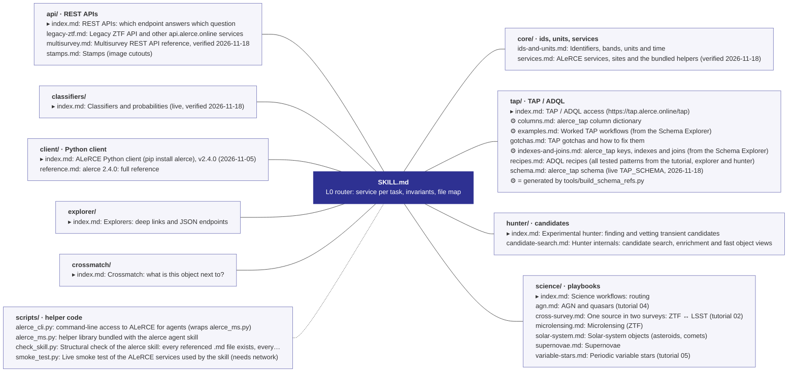

# ALeRCE agent skill

The `alerce/` skill is a hierarchical set of instructions and helper code that teaches an AI agent to use the [ALeRCE](https://alerce.science) alert broker. It is harness-agnostic: plain Markdown, a Python helper library and CLI, and public HTTP services. It works with any agent harness that supports the Agent Skills format (a folder with a `SKILL.md` whose frontmatter holds `name` and `description`), such as Claude Code, the Claude Agent SDK and claude.ai, and with any agent that can read files and run Python. It covers:
- the multisurvey REST API (`api-lsst.alerce.online`);
- the TAP/ADQL service (`tap.alerce.online`);
- the legacy ZTF API;
- stamps and crossmatch services;
- the experimental explorer and experimental hunter.

## Skill map
<!-- skill-map:start -->



*Skill map, generated by `tools/build_diagram.py` from the `alerce/` tree: 28 Markdown files in 9 areas and 4 scripts. The router (`SKILL.md`, centre) points to each area; ▸ marks the area's entry page, which points to the rest (an agent reads only what the task needs). ⚙ marks files generated from the alerce_tap Schema Explorer. Do not edit by hand.*

<!-- skill-map:end -->

The skill uses progressive disclosure:
- **L0 router.** `SKILL.md` says which service fits which task, lists the invariants and maps every file.
- **L1 index pages.** Each area has an `index.md`.
- **L2 references.** Full references, recipes and gotchas, read only when needed.

`core/` holds what every area shares. In a harness with skill support, only `SKILL.md`'s name and description sit in the model's context until the skill triggers; the agent then reads the router and opens deeper files only for the task at hand. All cross-references are relative paths, so the folder works wherever it is placed.

The map is generated from the `alerce/` tree by `tools/build_diagram.py`, so it changes whenever the tree does:
- **Locally:** a pre-commit hook regenerates it on every commit. Enable it once per clone with `git config core.hooksPath .githooks`.
- **On GitHub:** the `skill-map` workflow regenerates and commits it on every push to `master`, and fails pull requests whose map is stale.
- **In the tests:** an offline test checks that it is current.

The `tap/` reference files on keys, indexes and joins, the 725-column dictionary and the 8 workflows are generated from the [alerce_tap Schema Explorer](https://claude.ai/artifact/JEpEyijsTpD1y83ut7Zia7) by `tools/build_schema_refs.py`.

## Install
**Harnesses with Agent Skills support:** put (or symlink) the `alerce/` folder in the harness's skills directory. For example:
```bash
# Claude Code, all projects
ln -s "$PWD/alerce" ~/.claude/skills/alerce
# Claude Code, one project
mkdir -p <project>/.claude/skills && ln -s "$PWD/alerce" <project>/.claude/skills/alerce
```
For claude.ai, zip the `alerce/` folder and upload it as a skill. Other harnesses use their own skills directory; the folder needs no changes.

**Harnesses without skill support:** make the folder readable to the agent and add one line to its standing instructions (`AGENTS.md`, a system prompt, a rules file):
```
For any task involving ALeRCE, ZTF/LSST alerts or broker data, first read alerce/SKILL.md and follow its routing.
```
Everything else works the same, because the router and its file map lead the agent to the right files.

**What the agent needs:**
- the ability to read files;
- for the helpers (`scripts/`): Python with network access, and `numpy pandas requests pyvo astropy`. `astroquery scipy matplotlib` are optional, used for crossmatch, stamps and plots.

An agent that can only read files still gets the docs, the ADQL and the URLs, but not the helpers.

## Check
```bash
python alerce/scripts/check_skill.py        # structure: every referenced file exists, SKILL.md size
python alerce/scripts/smoke_test.py         # live: REST, TAP, stamps, cone search, hunter search
pip install -r requirements-test.txt && pytest   # 218 claim + drift tests; -m examples adds 69 workflow queries (see tests/README.md)
```
The claim tests verify the skill's factual statements against the live services. The drift tests compare classifiers, schemas, endpoints and features with `tests/baselines/`, so changes on the ALeRCE side surface as failing tests. A GitHub Actions workflow runs them weekly.

## Sources
The content was distilled from these sources (2026-11-18 and 2026-11-19):
- **The IUCAA 2026 ALeRCE multisurvey tutorial**, [github.com/fforster/alerce-iucaa-2026](https://github.com/fforster/alerce-iucaa-2026): `alerce_ms.py` and notebooks 00–05.
- **The experimental explorer**: [explorer-experiment.alerce.online](https://explorer-experiment.alerce.online), code at [github.com/fforster/alerce-explorer-experimental](https://github.com/fforster/alerce-explorer-experimental).
- **The experimental hunter**, [hunter-experiment.alerce.online](https://hunter-experiment.alerce.online), including its switch to REST for object views (about 5× faster).
- **ALeRCE's official use-case notebooks**, [github.com/alercebroker/usecases](https://github.com/alercebroker/usecases). These are the LSST notebooks and their `lib_multisurvey` helpers, the ZTF starters (SN, AGN, variable stars, asteroids, microlensing, fast SNe, periodograms, …) and the workshop notebooks.
  - They contributed TAP_UPLOAD, the microlensing and solar-system workflows, and the porting guide in `science/index.md`.
  - Many of them predate the multisurvey database and still use the legacy `ztf.*` schema, the legacy client or retired direct-SQL access; the skill records what is current.
- **The ALeRCE Python client** `alerce` 2.4.0, [pypi.org/project/alerce](https://pypi.org/project/alerce/), code at [github.com/alercebroker/alerce_client](https://github.com/alercebroker/alerce_client): source read in full and every public method exercised (`client/`).
- **The alerce_tap Schema Explorer**, [claude.ai/artifact/JEpEyijsTpD1y83ut7Zia7](https://claude.ai/artifact/JEpEyijsTpD1y83ut7Zia7): an interactive guide to every TAP table, column, index and relation, refreshed daily. `tools/build_schema_refs.py` generates `tap/indexes-and-joins.md`, `tap/columns.md` and `tap/examples.md` from it.
- **The live services themselves**:
  - the [multisurvey API](https://api-lsst.alerce.online/object_api/docs);
  - [TAP](https://tap.alerce.online/tap);
  - the [legacy ZTF API](https://api.alerce.online/ztf/v1);
  - [catsHTM](https://catshtm.alerce.online).

Facts were checked against the live services on those dates, and `tests/` re-checks them. Fast-moving facts (classifier versions, known issues) are dated in the files.
